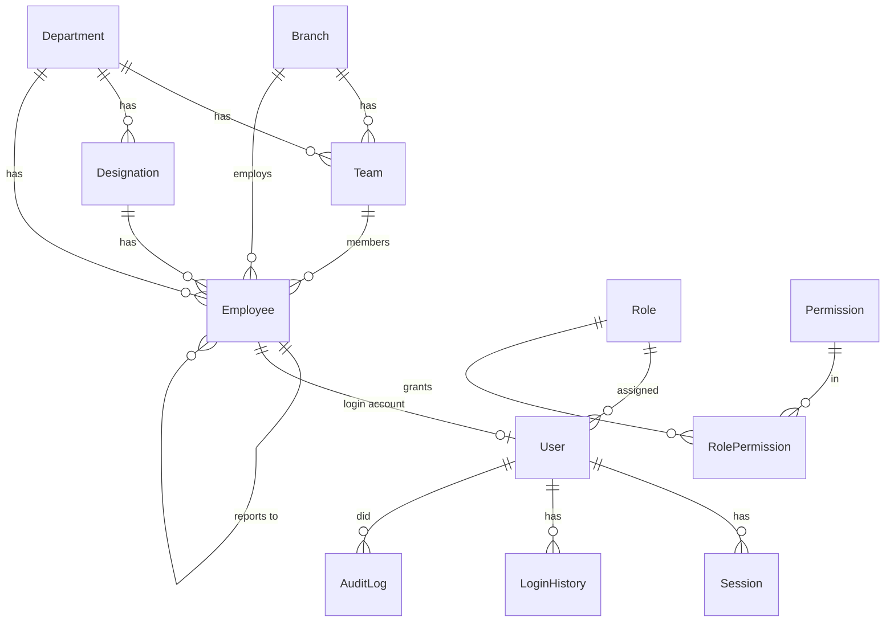
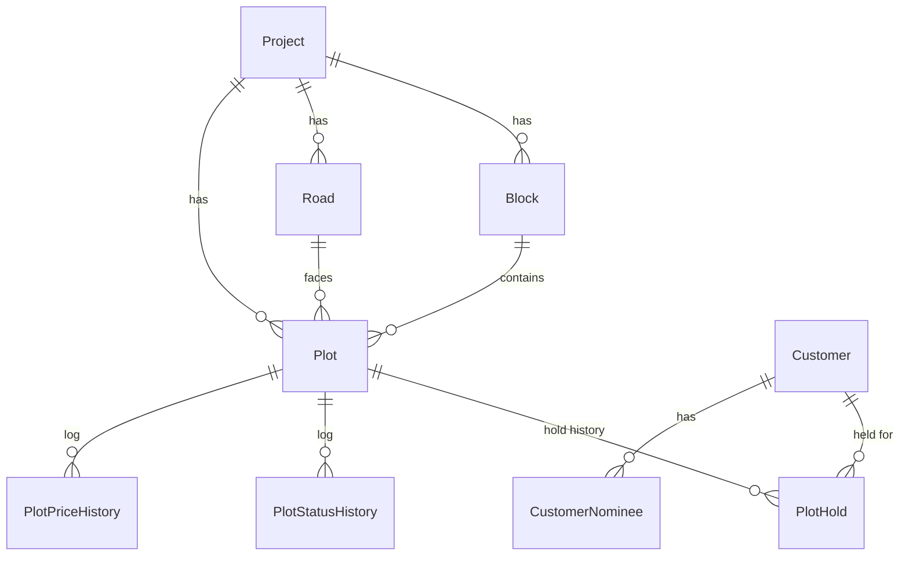
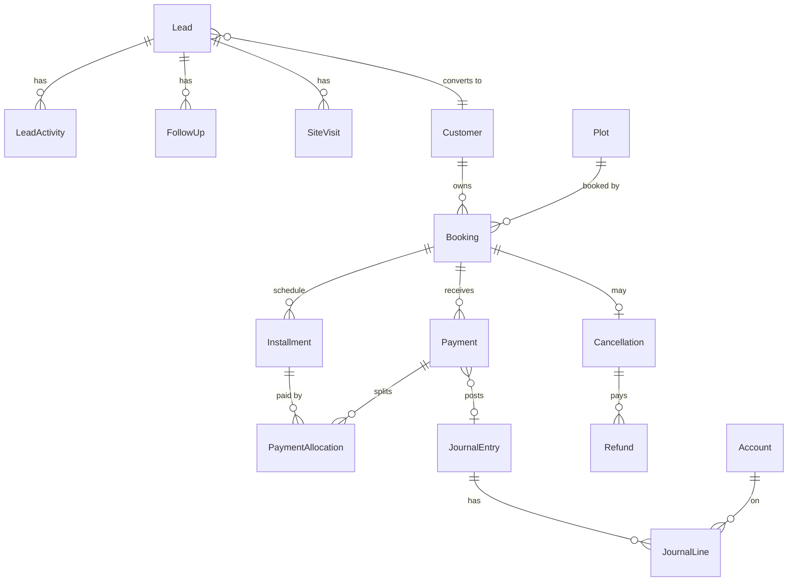

# 03 — Database Design

The blueprint warns that mistakes in **Plot Map, Booking, EMI, Collection, Accounts and Roles &
Permissions** would break the whole ERP later. So Phase 1–2 tables are designed in full here, and the
Phase 3 money tables are designed now too (even though they're built later), so Phase 1–2 doesn't
paint us into a corner. Phase 4–5 tables are only listed.

## 0. Global conventions

- PK `id` UUID v7 (`@default(uuid(7)) @db.Uuid`, time-ordered so indexes stay compact). Human codes (`code`, `bookingNo`, `receiptNo`) are separate, unique columns.
- Every table: `createdAt`, `updatedAt`; most also have `createdById`, `updatedById`.
- Master data: `deletedAt` (soft delete) + `isActive`. Financial tables: no delete, ever.
- Money: `Decimal(14,2)` BDT. Area: `Decimal(12,4)` stored in **sqft** (canonical), with the input
  unit kept for display (1 katha = 720 sqft, 1 decimal = 435.6 sqft).
- Timestamps in UTC (`timestamptz`); business dates (due date, booking date) as `date`.
- Phone numbers stored normalized `8801XXXXXXXXX`.
- Records that need data-scope filtering store `ownerId`, `teamId`, `departmentId`, `branchId`.
- Postgres features Prisma can't express (partial unique indexes, CHECK constraints) go into the
  migration SQL by hand and are listed here so they don't get lost.

---

## 1. Phase 1 — Foundation



### Organization

| Table                  | Key fields                                                                                                                                                                                                                                                                                                                                                                                   |
| ---------------------- | -------------------------------------------------------------------------------------------------------------------------------------------------------------------------------------------------------------------------------------------------------------------------------------------------------------------------------------------------------------------------------------------- |
| `Company` (single row) | name, legalName, logoFileId, address, phone, email, website, tin, bin, currency=BDT, timezone=Asia/Dhaka, fiscalYearStartMonth                                                                                                                                                                                                                                                               |
| `Setting`              | group (security, sms, email, facebook, maps, numbering, policy…), key, value JSON, isSecret (value encrypted)                                                                                                                                                                                                                                                                                |
| `Branch`               | code ✱, name, address, phone, isHeadOffice, isActive                                                                                                                                                                                                                                                                                                                                         |
| `Department`           | code ✱, name, headEmployeeId?, isActive                                                                                                                                                                                                                                                                                                                                                      |
| `Designation`          | name, departmentId?, level (int, for hierarchy/sorting)                                                                                                                                                                                                                                                                                                                                      |
| `Team`                 | name, branchId, departmentId, leaderId → Employee, isActive                                                                                                                                                                                                                                                                                                                                  |
| `Employee`             | employeeCode ✱, fullName, photoFileId, mobile, email, gender, dateOfBirth, nidNumber, bloodGroup, presentAddress, permanentAddress, emergencyContact JSON, branchId, departmentId, designationId, teamId?, reportingManagerId? (self), joiningDate, employmentType (PERMANENT, PROBATION, CONTRACT, INTERN), employmentStatus (ACTIVE, ON_LEAVE, SUSPENDED, RESIGNED, TERMINATED), exitDate? |

✱ = unique

### Auth & RBAC

| Table            | Key fields                                                                                                                                                                                                                                                                                             |
| ---------------- | ------------------------------------------------------------------------------------------------------------------------------------------------------------------------------------------------------------------------------------------------------------------------------------------------------ |
| `User`           | email ✱?, mobile ✱?, username ✱, passwordHash, employeeId ✱? (null for Super Admin/service users), roleId, status (ACTIVE, INACTIVE, LOCKED), mustChangePassword, passwordChangedAt, failedLoginCount, lockedUntil, twoFactorEnabled, twoFactorSecret (encrypted), backupCodes (hashed[]), lastLoginAt |
| `Role`           | name ✱, slug ✱, description, level (int; higher = more senior), isSystem (can't delete), permissionsVersion, require2FA                                                                                                                                                                                |
| `Permission`     | key ✱ (`booking.approve`), module (`booking`), action (`view/create/edit/delete/approve/export/print` or custom e.g. `unit.hold`), label, supportsScope (bool)                                                                                                                                         |
| `RolePermission` | roleId, permissionId, scope (OWN, TEAM, DEPARTMENT, BRANCH, ALL) — ✱(roleId, permissionId)                                                                                                                                                                                                             |
| `Session`        | userId, refreshTokenHash ✱, familyId, userAgent, deviceName, ip, lastUsedAt, expiresAt, revokedAt, revokeReason                                                                                                                                                                                        |
| `LoginHistory`   | userId?, identifier, success, failureReason, ip, userAgent, createdAt                                                                                                                                                                                                                                  |
| `OtpToken`       | userId, purpose (PASSWORD_RESET, TWO_FACTOR_SETUP…), codeHash, expiresAt, usedAt, attempts                                                                                                                                                                                                             |

> **Seeding roles & permissions** (`npm run db:seed`, idempotent): each module declares its
> permissions with `definePermissions()` in its manifest; the seed syncs that catalog and the 21
> system roles in `prisma/seed/core/roles.js`. Each role has a template of `[pattern, scope]` rules
> (`"lead.*" → OWN`, `"*.view" → ALL`). Templates are applied only to **new** roles and **new**
> permissions, so changes made in the permission matrix survive re-seeding. Super Admin also bypasses
> permission checks in code, so a missing grant can never lock the system owner out.

> One role per user keeps the matrix understandable. Team leadership is not a role — it comes
> from `Team.leaderId`, so a Sales Executive promoted to lead a team doesn't need a new role for scope.

### Platform

| Table          | Key fields                                                                                                                                                                                                                                                                                |
| -------------- | ----------------------------------------------------------------------------------------------------------------------------------------------------------------------------------------------------------------------------------------------------------------------------------------- |
| `AuditLog`     | userId?, action (CREATE, UPDATE, DELETE, LOGIN, LOGOUT, APPROVE, REJECT, EXPORT, PRINT, STATUS_CHANGE…), entityType, entityId, description, oldValues JSON, newValues JSON, changedFields text[], ip, userAgent, requestId, createdAt — idx(entityType, entityId), idx(userId, createdAt) |
| `File`         | storageKey ✱, originalName, mimeType, size, checksum, entityType?, entityId?, category (NID, PHOTO, AGREEMENT, DEED, MASTER_PLAN…), version, previousVersionId?, verificationStatus (PENDING, VERIFIED, REJECTED), verifiedById, expiresOn? (for expiry alerts), uploadedById             |
| `Sequence`     | key ✱ (`BOOKING:2026`), prefix, nextValue, padding                                                                                                                                                                                                                                        |
| `Notification` | userId, type, title, body, link, data JSON, readAt, createdAt — idx(userId, readAt)                                                                                                                                                                                                       |

---

## 2. Phase 2 — Real-Estate Core

Client decisions (2026-10-20): **plots only**; project land in **decimal**, plot size in **sqft**;
**each plot has its own price** (no corner/road premiums — they adjust the price instead);
layout plans are **images**; holds by Sales Manager and above with a **day limit and auto-release**,
recording who asked for the hold; a plot is **SOLD on registration**; **one owner per plot**.



| Table               | Key fields                                                                                                                                                                                                                                                                                                                                                                                                    |
| ------------------- | ------------------------------------------------------------------------------------------------------------------------------------------------------------------------------------------------------------------------------------------------------------------------------------------------------------------------------------------------------------------------------------------------------------- |
| `Project`           | code ✱, name, status (PLANNING, ONGOING, COMPLETED, ON_HOLD), description, address, district, upazila, latitude?, longitude?, landAreaDecimal (total land, decimal), launchDate?, expectedHandoverDate?, branchId, projectManagerId?, layoutFileId? (master-plan image), layoutWidth/layoutHeight (image pixels = map coordinate space), defaultHoldDays, isActive                                            |
| `Block`             | projectId, code, name, sortOrder, isActive — ✱(projectId, code)                                                                                                                                                                                                                                                                                                                                               |
| `Road`              | projectId, code/name, widthFeet? — ✱(projectId, code)                                                                                                                                                                                                                                                                                                                                                         |
| `Plot`              | projectId, blockId, roadId?, plotNumber, code (`A-102`, ✱ per project), areaSqft, dimensions? (`40×60 ft`), facing? (N/S/E/W/NE/NW/SE/SW), price (BDT, set per plot), status (AVAILABLE, HOLD, BOOKED, SOLD, BLOCKED), statusChangedAt, mapShape? JSON (polygon points in layout-image pixels), mapLabel? JSON {x,y}, remarks — idx(projectId, status). Rate per sqft is computed (price ÷ area), not stored. |
| `PlotHold`          | plotId, requestedById (employee who asked, e.g. sales executive), heldById (user who placed it — Sales Manager+), customerId?, customerName?/customerMobile? (prospect not yet a customer), reason, days, expiresAt, status (ACTIVE, RELEASED, EXPIRED, CONVERTED), releasedAt?, releasedById?, releaseReason?                                                                                                |
| `PlotStatusHistory` | plotId, fromStatus, toStatus, reason, refType (HOLD, RELEASE, EXPIRY, BLOCK, BOOKING, REGISTRATION, CANCELLATION), refId?, changedById?, createdAt                                                                                                                                                                                                                                                            |
| `PlotPriceHistory`  | plotId, oldPrice, newPrice, reason, changedById, createdAt                                                                                                                                                                                                                                                                                                                                                    |
| `Customer`          | customerCode ✱, fullName, fatherName, motherName, spouseName?, dateOfBirth?, gender?, nidNumber?, passportNumber?, tin?, profession?, organization?, mobile, altMobile?, email?, presentAddress, permanentAddress, photoFileId?, sourceLeadId?, ownerId (employee), teamId, departmentId, branchId, notes — idx(mobile), idx(nidNumber)                                                                       |
| `CustomerNominee`   | customerId, fullName, relation, nidNumber?, mobile?, sharePercent, photoFileId?                                                                                                                                                                                                                                                                                                                               |

**Status rules**

```
AVAILABLE → HOLD      (plot.hold: Sales Manager+, with day limit; who asked is recorded)
HOLD → AVAILABLE      (manual release, or automatic when the days run out)
AVAILABLE/HOLD → BOOKED    (booking confirmed — Phase 3)
BOOKED → SOLD         (registration recorded — Phase 3)
BOOKED → AVAILABLE    (cancellation — Phase 3)
AVAILABLE ↔ BLOCKED   (plot.block — management keeps a plot off the market)
```

**Concurrency** (a plot can never be held or booked twice):

```js
// inside a transaction
const { count } = await tx.plot.updateMany({
  where: { id: plotId, status: "AVAILABLE" }, // only if still available
  data: { status: "HOLD", statusChangedAt: new Date() },
});
if (count === 0) throw new AppError(409, "Plot is no longer available");
```

plus DB guards added in migration SQL:

```sql
CREATE UNIQUE INDEX plot_one_active_hold ON "PlotHold"("plotId") WHERE status = 'ACTIVE';
CREATE UNIQUE INDEX plot_one_active_booking ON "Booking"("plotId")
  WHERE status IN ('PENDING_APPROVAL','CONFIRMED','REGISTERED');  -- Phase 3
```

**Hold expiry**: a background job (every few minutes) releases ACTIVE holds whose `expiresAt` has
passed → plot AVAILABLE, hold EXPIRED, status history written, the requester notified.

### Approval engine (built in 3.0)

| Table              | Key fields                                                                                                                                                                                                                                                                                                                                                                                                                                             |
| ------------------ | ------------------------------------------------------------------------------------------------------------------------------------------------------------------------------------------------------------------------------------------------------------------------------------------------------------------------------------------------------------------------------------------------------------------------------------------------------ |
| `ApprovalWorkflow` | code ✱ (DISCOUNT, BOOKING, CANCELLATION, REFUND, PURCHASE, LEAVE, PAYROLL), name, description, module (owner), isActive (off = approved at once)                                                                                                                                                                                                                                                                                                       |
| `ApprovalStep`     | workflowId, stepOrder (✱ per workflow), name, approverType (ROLE, TEAM_LEADER, REPORTING_MANAGER, DEPARTMENT_HEAD, USER), approverRoleId?, approverUserId? (CHECK: matches type), sameBranch, maxAmount?, maxPercent?                                                                                                                                                                                                                                  |
| `ApprovalRequest`  | requestNo ✱ (APR-000001), workflowId, entityType, entityId, title, summary, link, requestedById, amount?, percent?, snapshot JSON, steps JSON (chain frozen at submission), status (PENDING, APPROVED, REJECTED, CANCELLED), currentStepOrder, finalStepOrder, currentApproverIds uuid[] (GIN, inbox), requester org stamp (employee/team/department/branch, for scope), completedAt — partial unique (workflowId, entityType, entityId) WHERE PENDING |
| `ApprovalAction`   | requestId, stepOrder, actorId (null = automatic), decision (SUBMITTED, APPROVED, REJECTED, CANCELLED, SKIPPED), comment, createdAt                                                                                                                                                                                                                                                                                                                     |

---

## 3. Phase 3 — Revenue engine (designed now, built in Phase 3)



**CRM**

- `LeadSource` (code ✱ generated from the name: FACEBOOK, WALK_IN…; name ✱, isActive, sortOrder — seeded from the client file, editable), `Campaign` (name, sourceId, budget, start/end (CHECK in validation), externalId ✱ for FB, notes, isActive, soft delete).
- `Lead` (built in 3.1a): leadCode ✱ (LD-000001), fullName, mobile (normalized), altMobile, email, location, profession, budgetMin/Max (CHECK min ≤ max), preferredProjectId, propertyType, sourceId, campaignId, externalRef ✱ (FB lead id), status (pipeline enum; CHECK LOST ⇒ lostReason, CONVERTED ⇒ convertedCustomerId), notes, nextFollowUpAt, lastActivityAt, duplicateOfId (accepted duplicate), convertedCustomerId, convertedAt, ownerId (assigned employee; null = pool) + teamId/departmentId/branchId stamped on (re)assignment, assignedAt — idx(mobile), idx(email), idx(ownerId, status), idx(nextFollowUpAt).
- `LeadActivity` (timeline, append-only: CREATED, NOTE, CALL, SMS, WHATSAPP, EMAIL, MEETING, STATUS_CHANGE, ASSIGNMENT, CONVERTED; from/to status, data JSON).
- Planned for 3.1b/c: `FollowUp` (dueAt, type, outcome, doneAt), `SiteVisit` (projectId, scheduledAt, visitedAt, transport, feedback, unitsShown), `LeadAssignmentRule` (type: ROUND_ROBIN/TEAM/PROJECT/LOCATION, config JSON, priority, pointer for round robin).

**Booking**

- `Booking`: bookingNo ✱, plotId, projectId, customerId (single owner), bookingDate, listPrice, discountAmount, discountPercent, discountApprovalId?, netPrice, additionalCharges (registration, utility…), totalPayable, bookingMoney, planType (ONE_TIME, INSTALLMENT), status (DRAFT, PENDING_APPROVAL, CONFIRMED, REGISTERED = plot SOLD, CANCELLED, TRANSFERRED), salesExecutiveId (=ownerId), teamId, departmentId, branchId, leadId?, approvalRequestId?, confirmedAt, priceSnapshot JSON.
- `BookingTransfer`: bookingId, fromCustomerId, toCustomerId, fee, approvalRequestId, transferredAt.

**EMI**

- `PaymentPlanTemplate` (per project: down-payment %, installment count, frequency) — optional presets.
- `Installment`: bookingId, seq, type (BOOKING_MONEY, DOWN_PAYMENT, INSTALLMENT, SPECIAL, CHARGE), dueDate, amount, paidAmount, lateFee, lateFeeWaived, status (DUE, PARTIAL, PAID, OVERDUE, WAIVED, CANCELLED), paidAt — idx(dueDate, status). CHECK paidAmount ≤ amount.
  Invariant: Σ amount of non-cancelled installments = booking.totalPayable.

**Collection**

- `Payment`: receiptNo ✱, bookingId, customerId, amount, method (CASH, BANK_TRANSFER, CHEQUE, BKASH, NAGAD, GATEWAY), depositAccountId (cash/bank COA account), bankName, chequeNo, chequeDate, txnRef, receivedAt, receivedById, status (PENDING_VERIFICATION, VERIFIED, REJECTED, BOUNCED, REVERSED), verifiedById, verifiedAt, journalEntryId, reversalOfId, ownerId/teamId/branchId (copied from booking for scope).
- `PaymentAllocation`: paymentId, installmentId, principalAmount, lateFeeAmount. Default allocation: oldest due first (late fee, then principal).
- Money receipt is generated from `Payment` (PDF), not stored as a separate entity.

**Cancellation & refund**

- `Cancellation`: bookingId, requestedAt, reason, totalPaid, deductionAmount, cancellationCharge, refundableAmount, policySnapshot JSON (the rule used, so the math is reproducible), status (REQUESTED, CALCULATED, APPROVED, REFUND_PENDING, COMPLETED, REJECTED), approvalRequestId.
- `Refund`: cancellationId, amount, method, paidAt, paidById, journalEntryId, status.

**Accounting engine** (double entry)

- `Account` (chart of accounts tree): code ✱, name, type (ASSET, LIABILITY, EQUITY, INCOME, EXPENSE), parentId, isGroup, systemKey ✱? (CASH, BANK_*, CUSTOMER_RECEIVABLE, CUSTOMER_ADVANCE, SALES_REVENUE, LATE_FEE_INCOME, CANCELLATION_INCOME, REFUND_PAYABLE…), isActive.
- `FiscalYear` (start, end, isClosed), `AccountingPeriod` (month, isLocked).
- `JournalEntry`: entryNo ✱, date, type (MANUAL, RECEIPT, REFUND, SALE, PAYROLL, PURCHASE, ADJUSTMENT), narration, sourceType, sourceId, status (DRAFT, POSTED, REVERSED), reversalOfId, postedById.
- `JournalLine`: entryId, accountId, debit, credit, projectId? (cost center), branchId?, partyType (CUSTOMER, VENDOR, EMPLOYEE)?, partyId?, narration. CHECK exactly one of debit/credit > 0; service guarantees Σdebit = Σcredit before posting.
- Auto-posting example (payment verified, if client treats pre-registration money as advance):
  `Dr Cash/Bank  — Cr Customer Advance (party = customer, project = X)`.
  Revenue recognition rule is a **client decision** (see open question 13) and is configurable.
- Customer ledger, project profitability, trial balance, P&L and balance sheet are all queries over `JournalLine`.

**Sales support**: `DiscountRequest` (via approval engine), `Quotation`, `CommissionRule`, `Commission` (employeeId, bookingId/paymentId, basis, rate, amount, status, payrollRunId?).

---

## 4. Phase 4–5 (listed only, designed at phase start)

- HR: `LeaveType`, `LeaveBalance`, `LeaveRequest`, `Holiday`, `Shift`, `AttendanceLog` (raw device punches), `Attendance` (daily summary), `EmployeeTransfer`, `Promotion`, `Resignation`.
- Payroll: `SalaryStructure`, `SalaryComponent`, `EmployeeSalary`, `PayrollRun`, `Payslip`, `PayslipLine`.
- Target: `Target` (level: COMPANY/DEPARTMENT/TEAM/EMPLOYEE, metric, period, value), achievement computed from source tables.
- Purchase: `Vendor`, `PurchaseRequest(+Item)`, `Rfq`, `VendorQuote`, `PurchaseOrder(+Item)`, `GoodsReceipt(+Item)`, `VendorInvoice`, `VendorPayment`.
- Inventory: `ItemCategory`, `Item` (sku, unit, reorderLevel), `Warehouse`, `StockMovement` (IN/OUT/TRANSFER/ADJUSTMENT — the stock ledger; current stock is derived/cached).
- Construction: `ProjectTask`, `Milestone`, `Contractor`, `SiteActivity`, `MaterialConsumption`, `ProjectExpense`.
- Legal: `LegalCase`, document verification uses `File` + approval.
- Marketing/Comm: `Campaign` spend, `MessageTemplate`, `OutboundMessage` (SMS/Email/WhatsApp log), `Announcement`.
- Integrations: `WebhookEvent` (raw FB payloads, idempotency), `IntegrationCredential` (encrypted).
